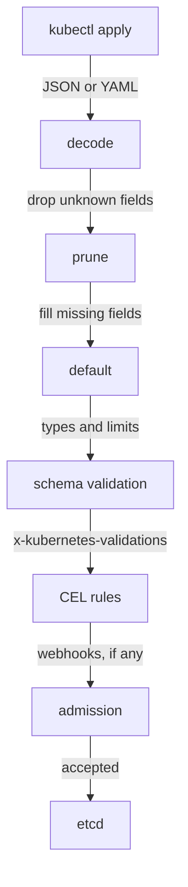

# What A CRD Adds To The API Server

A platform team that publishes a new resource type takes on the job of a small API designer. Users will send it objects with typos, wrong values and missing fields. This part looks at what a CustomResourceDefinition actually adds to the API server, follows one create request through the API server, and shows what a schema that checks nothing lets in.

## A new resource type, served like a built-in one

A CustomResourceDefinition (CRD) is a Kubernetes object that adds a new resource type to the API server. The API server is the Kubernetes component that accepts every read and write to the cluster and stores objects in etcd, the cluster's database. Once a CRD is **Established**, the API server serves the new type at its own address, and `kubectl` can get, apply, patch and delete its objects like Deployments. One object of the new type is called a **custom resource**.

<!-- astrona:playground:renew -->

List the CRDs in the playground, then the objects of the new type:

```sh
kubectl get crd
kubectl -n outpost get teamenvironments
```

You should see something like:

```text
NAME                                     CREATED AT
teamenvironments.platform.starfleet.io   2026-10-10T16:02:00Z
NAME    AGE
alpha   5s
beta    5s
gamma   5s
```

The CRD's name is always `<plural>.<group>`: here the plural `teamenvironments` and the group `platform.starfleet.io`. A group is the first part of an `apiVersion`, so objects of this type start with `apiVersion: platform.starfleet.io/v1alpha1` and `kind: TeamEnvironment`. The `kubectl get` output shows only a name and an age, because the CRD does not say which fields matter.

## What the weak schema lets in

The playground's CRD has a schema, but it only says that `spec` is an object and keeps whatever is inside it:

```yaml
      schema:
        openAPIV3Schema:
          type: object
          properties:
            spec:
              type: object
              x-kubernetes-preserve-unknown-fields: true
```

`openAPIV3Schema` is the part of a CRD that describes the fields of the new type, in the OpenAPI v3 schema format. `x-kubernetes-preserve-unknown-fields: true` tells the API server to keep fields the schema does not describe. Under `spec`, the schema describes nothing, so everything is kept and nothing is checked.

Read the `beta` object back from the API server:

```sh
kubectl -n outpost get teamenvironment beta -o yaml
```

You should see something like (the `last-applied-configuration` annotation is left out here):

```text
apiVersion: platform.starfleet.io/v1alpha1
kind: TeamEnvironment
metadata:
  creationTimestamp: "2026-10-10T16:02:02Z"
  generation: 1
  name: beta
  namespace: outpost
  resourceVersion: "512"
  uid: a1fc7986-48d1-4f9d-9756-5494ea58954e
spec:
  contact: lead@outpost.starfleet.io
  replcas: 3
  size: medium
  team: outpost
```

The field `replcas` is stored exactly as written. A controller that reads `spec.replicas` from this object would find nothing and use its own default, and the user who asked for 3 replicas would never learn why they got 1. The `gamma` object is worse: size `huge`, 50 replicas and a contact that is not an address were all accepted.

`kubectl explain` reads the same schema, so it has nothing to show either:

```sh
kubectl explain teamenvironment.spec
```

You should see:

```text
GROUP:      platform.starfleet.io
KIND:       TeamEnvironment
VERSION:    v1alpha1

FIELD: spec <Object>


DESCRIPTION:
    <empty>
```

## The path of a create request

To fix this, you need to know where the API server checks a custom resource. A create or update request passes these steps, in this order, before the object reaches etcd:



The diagram shows each step the API server runs on a custom resource, with the work each step does written on the arrow that enters it.

Each step uses the CRD's schema. **Decoding** turns the request into an object, and **pruning** drops the fields the schema does not declare, unless `x-kubernetes-preserve-unknown-fields` keeps them. **Defaulting** fills in missing fields that have a `default`. **Schema validation** checks types, required fields and limits such as `maximum`. **CEL rules** check expressions written in the Common Expression Language (CEL). Admission webhooks run last; this module uses none. If any step fails, the API server returns an error and stores nothing.

With the playground's schema, all of these steps have nothing to work with. The rest of this module fills in the schema one step at a time: first types, limits, defaults and pruning, then CEL rules, then the columns `kubectl get` shows.

You now know that a CRD adds a new resource type that the API server serves and stores like a built-in one, and that the CRD's schema is the only thing the API server checks a custom resource against. A schema that keeps unknown fields and types nothing lets typos and impossible values into etcd. The open question is how to write a schema that the API server can enforce, and what happens to the objects that are already stored.

## Common pitfalls

> [!WARNING]
> - **Expecting a CRD to check anything on its own.** The API server checks only what the schema says. A schema that types nothing checks nothing.
> - **Using `x-kubernetes-preserve-unknown-fields` to "save time".** It turns off pruning for that object, so typos are stored and never reported.
> - **Looking for the fault in `kubectl get`.** Without printer columns it shows only a name and an age. Read the object with `-o yaml`.
> - **Forgetting the CRD name format.** It is always `<plural>.<group>`, and the API server rejects a CRD whose name does not match its `spec.names.plural` and `spec.group`.
