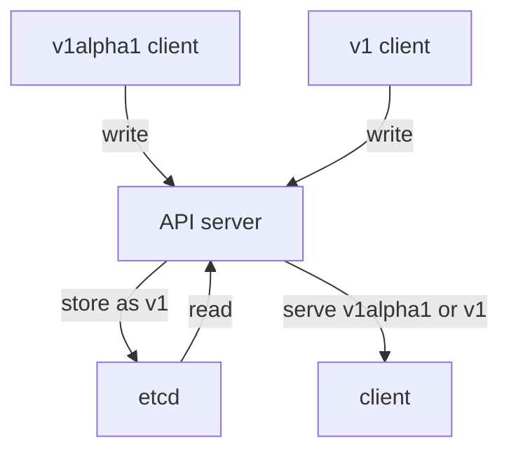

# Served Versions And Storage Versions

A platform API can serve more than one version of the same resource type. A client may still send `v1alpha1`, while a newer client sends `v1`. The API server accepts both only when the CustomResourceDefinition lists both versions as served versions. This part adds `v1` beside `v1alpha1` and makes `v1` the storage version.

## The starting version

A **served version** is a CRD version the API server accepts from clients. A **storage version** is the one version the API server writes to etcd, the cluster database. A CRD can serve several versions, but only one version can have `storage: true`.

<!-- astrona:playground:renew -->

Read the versions in the starting CRD:

```sh
kubectl get crd teamenvironments.platform.starfleet.io \
  -o jsonpath='{range .spec.versions[*]}{.name}{" served="}{.served}{" storage="}{.storage}{"\n"}{end}'
kubectl get crd teamenvironments.platform.starfleet.io \
  -o jsonpath='{.status.storedVersions}{"\n"}'
```

You should see:

```text
v1alpha1 served=true storage=true
["v1alpha1"]
```

`status.storedVersions` lists the versions that may still exist in etcd. It starts with only `v1alpha1`, because every stored `TeamEnvironment` was created while `v1alpha1` was the storage version.

Read one object through the current version:

```sh
kubectl -n outpost get teamenvironment alpha -o jsonpath='{.apiVersion}{" replicas="}{.spec.replicas}{"\n"}'
```

You should see:

```text
platform.starfleet.io/v1alpha1 replicas=2
```

The object is served as `v1alpha1` because that is the only served version.

## Add v1 without a webhook

When a CRD serves more than one version, the API server must convert objects between those versions. A **conversion strategy** is the rule the API server uses for that conversion. This module uses `strategy: None`: the API server changes only the `apiVersion` field and leaves every other field as it is. That is safe here because `v1` uses the same schema as `v1alpha1`.



The diagram shows the API server accepting either served version while storing the object in one storage version.

Save this as `crd-teamenvironment-versions.yaml`:

```yaml
apiVersion: apiextensions.k8s.io/v1
kind: CustomResourceDefinition
metadata:
  name: teamenvironments.platform.starfleet.io
spec:
  group: platform.starfleet.io
  scope: Namespaced
  names:
    kind: TeamEnvironment
    plural: teamenvironments
    singular: teamenvironment
    shortNames:
      - teamenv
  conversion:
    strategy: None
  versions:
    - name: v1alpha1
      served: true
      storage: false
      additionalPrinterColumns:
        - name: Size
          type: string
          jsonPath: .spec.size
        - name: Replicas
          type: integer
          jsonPath: .spec.replicas
        - name: Ready
          type: integer
          jsonPath: .status.readyReplicas
      schema:
        openAPIV3Schema:
          type: object
          properties:
            spec:
              type: object
              required:
                - team
                - size
              properties:
                team:
                  type: string
                size:
                  type: string
                  enum:
                    - small
                    - medium
                    - large
                replicas:
                  type: integer
                  minimum: 0
                  maximum: 5
                  default: 1
            status:
              type: object
              properties:
                readyReplicas:
                  type: integer
                phase:
                  type: string
    - name: v1
      served: true
      storage: true
      additionalPrinterColumns:
        - name: Size
          type: string
          jsonPath: .spec.size
        - name: Replicas
          type: integer
          jsonPath: .spec.replicas
        - name: Ready
          type: integer
          jsonPath: .status.readyReplicas
      schema:
        openAPIV3Schema:
          type: object
          properties:
            spec:
              type: object
              required:
                - team
                - size
              properties:
                team:
                  type: string
                size:
                  type: string
                  enum:
                    - small
                    - medium
                    - large
                replicas:
                  type: integer
                  minimum: 0
                  maximum: 5
                  default: 1
            status:
              type: object
              properties:
                readyReplicas:
                  type: integer
                phase:
                  type: string
```

Apply it:

```sh
kubectl apply -f crd-teamenvironment-versions.yaml
```

You should see:

```text
customresourcedefinition.apiextensions.k8s.io/teamenvironments.platform.starfleet.io configured
```

Then check the version flags:

```sh
kubectl get crd teamenvironments.platform.starfleet.io \
  -o jsonpath='{range .spec.versions[*]}{.name}{" served="}{.served}{" storage="}{.storage}{"\n"}{end}'
kubectl get crd teamenvironments.platform.starfleet.io \
  -o jsonpath='{.status.storedVersions}{"\n"}'
```

You should see:

```text
v1alpha1 served=true storage=false
v1 served=true storage=true
["v1alpha1","v1"]
```

The spec now says that new writes are stored as `v1`. The API server added `v1` to `status.storedVersions` as soon as `v1` became the storage version. It kept `v1alpha1` in the list, because `alpha` and `beta` are still stored that way. Kubernetes does not rewrite existing custom resources just because the storage version changed.

## Read and write through both versions

When a command names only the resource (`teamenvironment`), `kubectl` uses the **preferred version** of the API group. The API server picks it by version priority, not by the order in the CRD: a stable `v1` comes before `v1beta1`, and `v1beta1` comes before `v1alpha1`. The API group discovery document shows the choice:

```sh
kubectl get --raw /apis/platform.starfleet.io
```

You should see:

```text
{"kind":"APIGroup","apiVersion":"v1","name":"platform.starfleet.io","versions":[{"groupVersion":"platform.starfleet.io/v1","version":"v1"},{"groupVersion":"platform.starfleet.io/v1alpha1","version":"v1alpha1"}],"preferredVersion":{"groupVersion":"platform.starfleet.io/v1","version":"v1"}}
```

The preferred version is now `v1`. `kubectl` keeps a discovery cache, so for a few seconds right after the CRD change a plain `kubectl get teamenvironment` may still answer with `v1alpha1`. To choose a version directly, put the version in the resource name:

```sh
kubectl -n outpost get teamenvironments.v1.platform.starfleet.io alpha \
  -o jsonpath='{.apiVersion}{" replicas="}{.spec.replicas}{"\n"}'
kubectl -n outpost get teamenvironments.v1alpha1.platform.starfleet.io alpha \
  -o jsonpath='{.apiVersion}{" replicas="}{.spec.replicas}{"\n"}'
```

You should see:

```text
platform.starfleet.io/v1 replicas=2
platform.starfleet.io/v1alpha1 replicas=2
```

Both reads return the same object data. The API server converts the stored object to the version the client requested.

Now create a new object through `v1`. Save this as `teamenvironment-gamma.yaml`:

```yaml
apiVersion: platform.starfleet.io/v1
kind: TeamEnvironment
metadata:
  name: gamma
  namespace: outpost
spec:
  team: outpost
  size: large
  replicas: 4
```

Apply it:

```sh
kubectl apply -f teamenvironment-gamma.yaml
kubectl -n outpost get teamenvironments.v1.platform.starfleet.io gamma \
  -o jsonpath='{.apiVersion}{" replicas="}{.spec.replicas}{"\n"}'
kubectl get crd teamenvironments.platform.starfleet.io \
  -o jsonpath='{.status.storedVersions}{"\n"}'
```

You should see:

```text
teamenvironment.platform.starfleet.io/gamma created
platform.starfleet.io/v1 replicas=4
["v1alpha1","v1"]
```

The list is the same as before: `gamma` is stored as `v1`, and `alpha` and `beta` are still stored as `v1alpha1`. The API server never removes a version from `status.storedVersions` by itself. To retire `v1alpha1` from storage, an administrator first rewrites every old object (a read and an unchanged write stores it as `v1`), then patches the CRD status so the list holds only `v1`. This module does not run that storage migration.

You can now add a served version and choose which version the API server uses for new storage. You have also seen that changing the storage flag does not rewrite old objects. The open question is how to keep an old version available while telling users to stop using it.

## Common pitfalls

> [!WARNING]
> - **Thinking `served` and `storage` mean the same thing.** `served` controls what clients may send and read. `storage` controls what the API server writes to etcd.
> - **Setting `storage: true` on two versions.** A CRD may have many served versions, but only one storage version. The API server refuses the CRD with `must have exactly one version marked as storage version`.
> - **Expecting `status.storedVersions` to clean itself up.** The API server adds versions to the list but never removes them. Remove an old version only after every object is rewritten.
> - **Renaming fields with `strategy: None`.** None conversion works only when both versions use the same field names and compatible schemas.
> - **Expecting existing objects to change storage version immediately.** The storage flag affects new writes. Old objects remain in the old stored version until rewritten or migrated.
