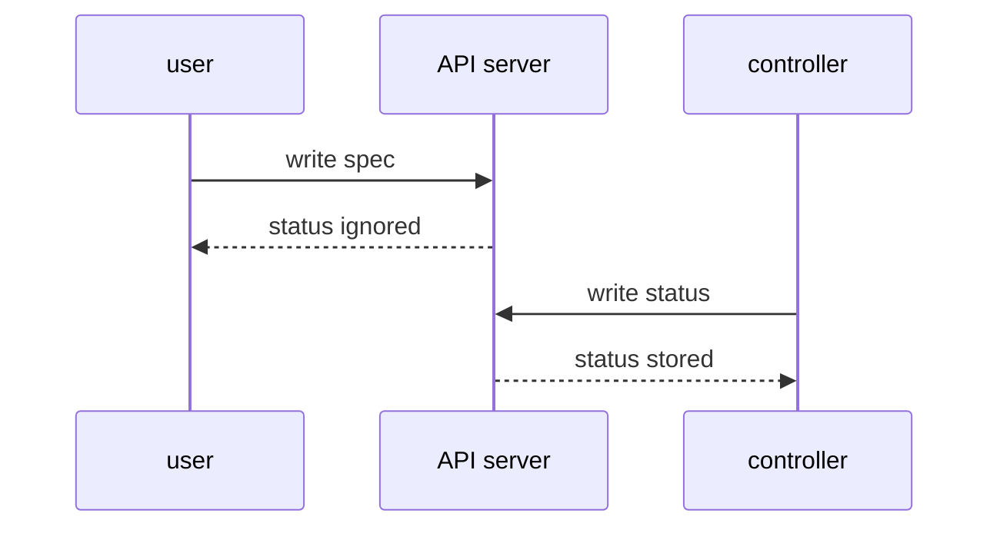

# Write Status Through The Status Subresource

A custom resource has two main parts. `spec` is the desired state that a user writes. `status` is the observed state that a controller writes after it has acted. The `status` subresource gives those two actors separate API endpoints, so a user update to `spec` cannot overwrite the controller's status by accident.

## Enable the status endpoint

A **subresource** is an extra endpoint for a resource. The `status` subresource serves `/status` for a custom resource. When it is enabled, normal create and update requests ignore `status`, and only requests to `/status` may change it.

<!-- astrona:playground:renew -->



The diagram shows the API server accepting `spec` through the main resource endpoint and `status` through the status subresource.

Save this as `crd-teamenvironment-status.yaml`:

```yaml
apiVersion: apiextensions.k8s.io/v1
kind: CustomResourceDefinition
metadata:
  name: teamenvironments.platform.starfleet.io
spec:
  group: platform.starfleet.io
  scope: Namespaced
  names:
    kind: TeamEnvironment
    plural: teamenvironments
    singular: teamenvironment
    shortNames:
      - teamenv
  conversion:
    strategy: None
  versions:
    - name: v1alpha1
      served: false
      storage: false
      schema:
        openAPIV3Schema:
          type: object
          properties:
            spec:
              type: object
              x-kubernetes-preserve-unknown-fields: true
    - name: v1
      served: true
      storage: true
      subresources:
        status: {}
      additionalPrinterColumns:
        - name: Size
          type: string
          jsonPath: .spec.size
        - name: Replicas
          type: integer
          jsonPath: .spec.replicas
        - name: Ready
          type: integer
          jsonPath: .status.readyReplicas
      schema:
        openAPIV3Schema:
          type: object
          properties:
            spec:
              type: object
              required:
                - team
                - size
              properties:
                team:
                  type: string
                size:
                  type: string
                  enum:
                    - small
                    - medium
                    - large
                replicas:
                  type: integer
                  minimum: 0
                  maximum: 5
                  default: 1
            status:
              type: object
              properties:
                readyReplicas:
                  type: integer
                phase:
                  type: string
```

Apply it:

```sh
kubectl apply -f crd-teamenvironment-status.yaml
```

You should see:

```text
customresourcedefinition.apiextensions.k8s.io/teamenvironments.platform.starfleet.io configured
```

## A normal apply cannot write status

Save this as `teamenvironment-alpha-with-status.yaml`:

```yaml
apiVersion: platform.starfleet.io/v1
kind: TeamEnvironment
metadata:
  name: alpha
  namespace: outpost
spec:
  team: outpost
  size: small
  replicas: 2
status:
  readyReplicas: 2
  phase: Ready
```

Apply it, then read `status`:

```sh
kubectl apply -f teamenvironment-alpha-with-status.yaml
kubectl -n outpost get teamenvironment alpha -o jsonpath='{.status}{"\n"}'
```

You should see:

```text
teamenvironment.platform.starfleet.io/alpha configured
```

The second command prints an empty line. The API server ignored `status` on the normal endpoint. That is the protection the subresource gives a controller.

## Act like the controller

No controller runs in the playground, so write status by hand through the status subresource:

```sh
kubectl -n outpost patch teamenvironment alpha \
  --subresource=status \
  --type merge \
  -p '{"status":{"readyReplicas":2,"phase":"Ready"}}'
kubectl -n outpost get teamenvironment alpha \
  -o jsonpath='{.status.readyReplicas}{" "}{.status.phase}{"\n"}'
```

You should see:

```text
teamenvironment.platform.starfleet.io/alpha patched
2 Ready
```

The patch reached `/status`, so the API server stored it. The printer column also reads the value now:

```sh
kubectl -n outpost get teamenv alpha
```

You should see:

```text
NAME    SIZE    REPLICAS   READY
alpha   small   2          2
```

The `READY` column comes from `.status.readyReplicas`. A real controller would update this value after it counted ready pods or checked another system.

Try to change `spec` through the status subresource:

```sh
kubectl -n outpost patch teamenvironment alpha \
  --subresource=status \
  --type merge \
  -p '{"spec":{"replicas":5},"status":{"phase":"Scaled"}}'
kubectl -n outpost get teamenvironment alpha \
  -o jsonpath='{.spec.replicas}{" "}{.status.phase}{"\n"}'
```

You should see:

```text
teamenvironment.platform.starfleet.io/alpha patched
2 Scaled
```

The status endpoint ignored `spec`, just as the main endpoint ignored `status`. You can now keep user intent and controller observation separate. The open question is how to make a custom resource work with tools that expect the standard Kubernetes scale endpoint.

## Common pitfalls

> [!WARNING]
> - **Writing status through the main endpoint after the subresource exists.** The API server ignores it, so the command may look successful while status stays unchanged.
> - **Letting users write both `spec` and `status`.** The point of the subresource is to give controllers a separate write path and separate RBAC.
> - **Expecting status to update itself.** A CRD only defines the field. A controller must write the values.
> - **Patching `spec` through `/status`.** The status endpoint ignores `spec`, so the desired state does not change.
