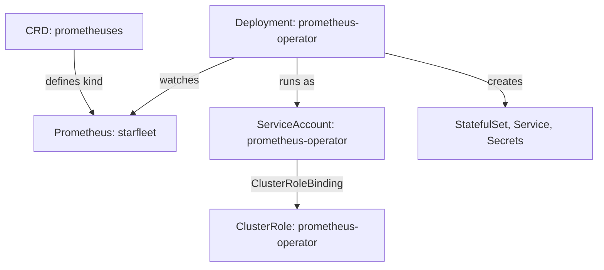

# What An Operator Installs

Before you can read what an operator does, you must find it. An operator is not one object. It is a set of CRDs, a Deployment that runs the controller, a ServiceAccount the controller runs as, and RBAC rules that say what that ServiceAccount may change. On an exam cluster nobody tells you where these live, so this part finds each one with `kubectl`.

## The CRDs: the API the operator adds

The Prometheus Operator adds its kinds to the API group `monitoring.coreos.com`. An API group is the first part of an `apiVersion`, and every CRD in one group shares it. `kubectl api-resources` lists every kind the API server serves in a group.

<!-- astrona:playground:renew -->

List the kinds of the operator's API group:

```sh
kubectl api-resources --api-group=monitoring.coreos.com
```

You should see:

```text
NAME                  SHORTNAMES   APIVERSION                       NAMESPACED   KIND
alertmanagerconfigs   amcfg        monitoring.coreos.com/v1alpha1   true         AlertmanagerConfig
alertmanagers         am           monitoring.coreos.com/v1         true         Alertmanager
podmonitors           pmon         monitoring.coreos.com/v1         true         PodMonitor
probes                prb          monitoring.coreos.com/v1         true         Probe
prometheusagents      promagent    monitoring.coreos.com/v1alpha1   true         PrometheusAgent
prometheuses          prom         monitoring.coreos.com/v1         true         Prometheus
prometheusrules       promrule     monitoring.coreos.com/v1         true         PrometheusRule
scrapeconfigs         scfg         monitoring.coreos.com/v1alpha1   true         ScrapeConfig
servicemonitors       smon         monitoring.coreos.com/v1         true         ServiceMonitor
thanosrulers          ruler        monitoring.coreos.com/v1         true         ThanosRuler
```

Ten CRDs, all namespaced. This module uses one of them, `Prometheus`: one object of this kind asks for one Prometheus server. `ServiceMonitor` tells that server which Services to collect metrics from. The other kinds belong to other controllers inside the same operator.

## The controller Deployment and its identity

The CRDs only add API types. The program that acts on them runs in a normal Deployment. In this playground the release bundle put it in the `default` namespace:

```sh
kubectl -n default get deployment prometheus-operator
```

You should see:

```text
NAME                  READY   UP-TO-DATE   AVAILABLE   AGE
prometheus-operator   1/1     1            1           24s
```

Your `AGE` differs. Every request the controller sends to the API server is made as the ServiceAccount of its pod. Read that ServiceAccount and the controller image from the Deployment:

```sh
kubectl -n default get deployment prometheus-operator \
  -o jsonpath='{.spec.template.spec.serviceAccountName}{"\n"}{.spec.template.spec.containers[0].image}{"\n"}'
```

You should see:

```text
prometheus-operator
quay.io/prometheus-operator/prometheus-operator:v0.94.1
```

The controller runs as the ServiceAccount `prometheus-operator` in `default`. That name is the key to its permissions.

## The RBAC rules: what the controller may change

Role-based access control (RBAC) decides what each identity may do in the API server. A ClusterRole lists rules: API groups, resources and verbs. A ClusterRoleBinding gives a ClusterRole to a subject, such as a ServiceAccount. Find the binding for the operator:

```sh
kubectl get clusterrolebinding prometheus-operator \
  -o jsonpath='{.roleRef.kind}{"/"}{.roleRef.name}{" -> "}{.subjects[0].kind}{" "}{.subjects[0].namespace}{"/"}{.subjects[0].name}{"\n"}'
```

You should see:

```text
ClusterRole/prometheus-operator -> ServiceAccount default/prometheus-operator
```

Now read the rules of that ClusterRole, one line per rule:

```sh
kubectl get clusterrole prometheus-operator \
  -o jsonpath='{range .rules[*]}{.apiGroups}{" "}{.resources}{" "}{.verbs}{"\n"}{end}'
```

You should see:

```text
["monitoring.coreos.com"] ["alertmanagers","alertmanagers/finalizers","prometheusagents","prometheusagents/finalizers","prometheuses","prometheuses/finalizers","thanosrulers","thanosrulers/finalizers"] ["patch"]
["monitoring.coreos.com"] ["alertmanagers/finalizers","prometheusagents/finalizers","prometheuses/finalizers","thanosrulers/finalizers"] ["update"]
["monitoring.coreos.com"] ["alertmanagers/status","podmonitors/status","probes/status","prometheuses/status","prometheusagents/status","prometheusrules/status","scrapeconfigs/status","servicemonitors/status","thanosrulers/status"] ["create","update","patch","delete"]
["monitoring.coreos.com"] ["alertmanagers","alertmanagerconfigs","podmonitors","probes","prometheusagents","prometheuses","prometheusrules","servicemonitors","scrapeconfigs","thanosrulers"] ["get","list","watch"]
["apps"] ["statefulsets"] ["get","list","watch","create","update","patch","delete"]
[""] ["configmaps","secrets"] ["get","list","watch","create","update","delete"]
[""] ["pods"] ["list","delete"]
[""] ["services","services/finalizers"] ["get","create","update","delete"]
[""] ["nodes"] ["list","watch"]
[""] ["namespaces"] ["get","list","watch"]
["events.k8s.io"] ["events"] ["patch","create"]
["networking.k8s.io"] ["ingresses"] ["get","list","watch"]
["storage.k8s.io"] ["storageclasses"] ["get"]
[""] ["endpoints"] ["get","create","update","delete"]
```

The rules tell you the shape of the reconcile loop before you see it run. The controller may only `get`, `list` and `watch` its own custom resources: it reads the desired state, it never creates it. It writes to the `/status` subresource, so status is its job. It may create and change StatefulSets, Secrets, ConfigMaps and Services: those are the objects it builds.

`kubectl auth can-i` asks the API server the same question for one action. With `--as` you ask it as another identity, here the operator's ServiceAccount:

```sh
kubectl auth can-i create statefulsets -n starfleet \
  --as=system:serviceaccount:default:prometheus-operator
kubectl auth can-i create deployments -n starfleet \
  --as=system:serviceaccount:default:prometheus-operator
```

You should see:

```text
yes
no
```

The controller may create StatefulSets but not Deployments. So when a `Prometheus` resource needs pods, the operator must build a StatefulSet. A ServiceAccount name has the form `system:serviceaccount:<namespace>:<name>` when you use it with `--as`.

## The custom resources it acts on

Last, list the objects the controller works for. The `Prometheus` CRD defines extra printer columns, so `kubectl get` already shows a summary of the status the controller wrote:

```sh
kubectl -n starfleet get prometheus
```

You should see:

```text
NAME        VERSION   DESIRED   READY   RECONCILED   AVAILABLE   AGE
broken                1         0       True         False       21s
starfleet             1         1       True         True        21s
```

`starfleet` asks for one replica and has one ready. `broken` asks for one and has none. Both say `RECONCILED True`, which looks strange for a resource that does not work; the reason comes later in this module.



The diagram shows the four pieces of an operator: the CRD that defines the kind, the controller Deployment that watches objects of that kind, the ServiceAccount it runs as, and the ClusterRole that limits what it may create.

You can now find every piece of an operator from the cluster: its kinds with `kubectl api-resources`, its controller Deployment, the ServiceAccount it runs as, and its permissions with `kubectl auth can-i --as`. The RBAC rules already showed that the operator builds StatefulSets, Services and Secrets. The open question is which of those objects belong to which custom resource.

## Common pitfalls

> [!WARNING]
> - **Looking for the controller in the namespace of the custom resource.** The controller runs where it was installed (`default` here), and it watches custom resources in other namespaces.
> - **Reading a ClusterRole without its binding.** A ClusterRole gives nothing until a ClusterRoleBinding or RoleBinding names a subject. Check both.
> - **Forgetting the `system:serviceaccount:` prefix with `--as`.** `--as=prometheus-operator` asks about a user with that name, not the ServiceAccount, so the answer is about the wrong identity.
> - **Thinking a CRD does the work.** Without the controller Deployment, the API server still stores `Prometheus` objects, but no Prometheus server ever starts.
