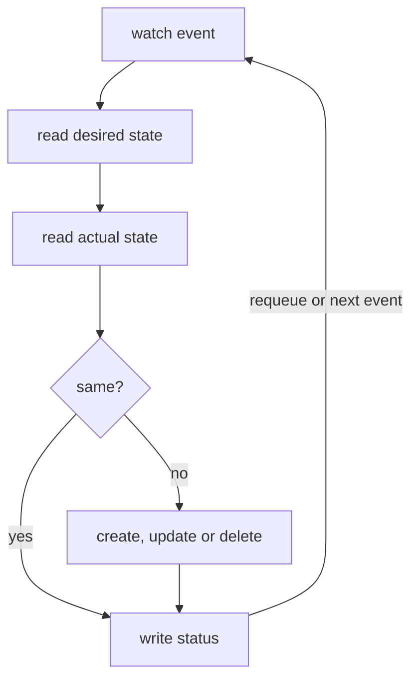
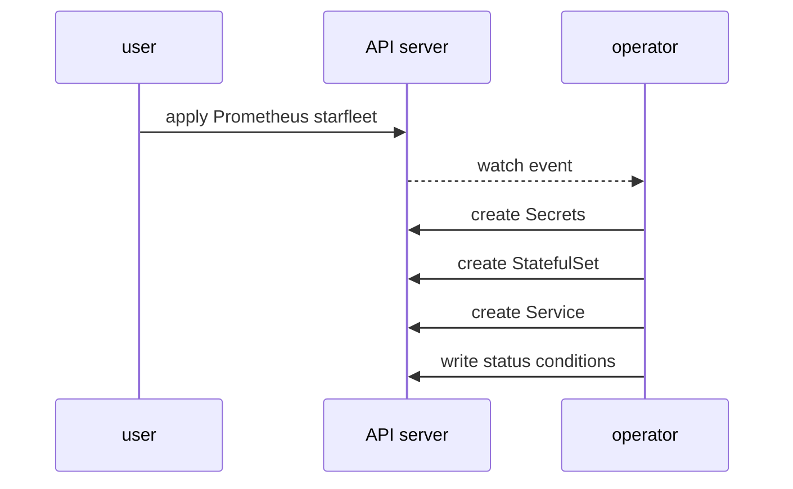

# Follow A Custom Resource To Its Objects

A user applies one small `Prometheus` object. A few seconds later a StatefulSet, a Service, several Secrets and a pod exist. When something goes wrong, you must walk that path in both directions: from the custom resource to what was built, and from a strange pod back to the object that asked for it. Kubernetes records that path in every built object.

## The reconcile loop

The controller does not run once. It runs the reconcile loop every time something it watches changes: a `Prometheus` object, a StatefulSet it owns, a Secret it reads. One pass of the loop for one object is one reconcile.



The diagram shows one reconcile: an event starts it, the controller compares the custom resource with the cluster, fixes the difference, writes status and waits for the next event.

For the `Prometheus` resource `starfleet`, the first reconcile created all the objects it needs, in one pass:



The diagram shows that the user talks only to the API server; the operator learns about the new object from its watch and creates the other objects through the API server too.

## Owner references: the link back to the custom resource

An `ownerReference` is a link in `metadata.ownerReferences` from a child object to its parent. It names the parent's kind, name and `uid`, the unique ID the API server gave the parent. The garbage collector deletes the child when the parent goes, and `controller: true` marks the one owner that manages the child.

<!-- astrona:playground:renew -->

Read the `uid` of the `Prometheus` resource:

```sh
kubectl -n starfleet get prometheus starfleet -o jsonpath='{.metadata.uid}{"\n"}'
```

You should see:

```text
c9c63508-703b-4f78-8f00-ad1330b0dda0
```

Your `uid` differs. Now list the StatefulSets, Services and Secrets in `starfleet` with their owners:

```sh
kubectl -n starfleet get statefulset,service,secret \
  -o custom-columns='KIND:.kind,NAME:.metadata.name,OWNER:.metadata.ownerReferences[*].name,CONTROLLER:.metadata.ownerReferences[*].controller'
```

You should see:

```text
KIND          NAME                                                      OWNER              CONTROLLER
StatefulSet   prometheus-broken                                         broken             true
StatefulSet   prometheus-starfleet                                      starfleet          true
Service       prometheus-operated                                       starfleet,broken   <none>
Service       scout                                                     <none>             <none>
Secret        prometheus-broken                                         broken             true
Secret        prometheus-broken-thanos-prometheus-http-client-file      broken             true
Secret        prometheus-broken-tls-assets-0                            broken             true
Secret        prometheus-broken-web-config                              broken             true
Secret        prometheus-starfleet                                      starfleet          true
Secret        prometheus-starfleet-thanos-prometheus-http-client-file   starfleet          true
Secret        prometheus-starfleet-tls-assets-0                         starfleet          true
Secret        prometheus-starfleet-web-config                           starfleet          true
```

Each `Prometheus` resource owns one StatefulSet and four Secrets, and is their controller. The Secret `prometheus-starfleet` holds the generated Prometheus configuration. The Service `prometheus-operated` is shared: both `Prometheus` resources own it, and neither is its controller, so it is deleted only when both are gone. `scout` has no owner, because a user created it.

Read the full owner reference on the StatefulSet:

```sh
kubectl -n starfleet get statefulset prometheus-starfleet -o jsonpath='{.metadata.ownerReferences}{"\n"}'
```

You should see:

```text
[{"apiVersion":"monitoring.coreos.com/v1","blockOwnerDeletion":true,"controller":true,"kind":"Prometheus","name":"starfleet","uid":"c9c63508-703b-4f78-8f00-ad1330b0dda0"}]
```

The `uid` is the one you read from the `Prometheus` resource. A name alone is not enough: if someone deletes `starfleet` and creates a new object with the same name, the new object has a new `uid`, and the garbage collector treats the old children as orphans. `blockOwnerDeletion: true` matters for foreground deletion, where the owner waits until this child is gone.

The chain goes one step further down. The pod belongs to the StatefulSet, not to the `Prometheus` resource:

```sh
kubectl -n starfleet get pod prometheus-starfleet-0 \
  -o jsonpath='{.metadata.ownerReferences[0].kind}{"/"}{.metadata.ownerReferences[0].name}{"\n"}'
```

You should see:

```text
StatefulSet/prometheus-starfleet
```

So the full path is `Prometheus` → StatefulSet → pod. Two controllers share the work: the Prometheus Operator builds the StatefulSet, and the built-in StatefulSet controller of Kubernetes creates the pod from it.

## The controller puts back what you change

An owned object is not yours to edit. The controller compares it with the custom resource on every reconcile and changes it back. Scale the StatefulSet to zero by hand and read its replica count right after:

```sh
kubectl -n starfleet scale statefulset prometheus-starfleet --replicas=0
kubectl -n starfleet get statefulset prometheus-starfleet -o jsonpath='{.spec.replicas}{"\n"}'
```

You should see:

```text
statefulset.apps/prometheus-starfleet scaled
1
```

The API server accepted your change, and the operator set `replicas` back to `1` within the same second. The change to a StatefulSet it owns was a watch event, so the operator ran a reconcile for `starfleet`. Its log shows the reconcile:

```sh
kubectl -n default logs deploy/prometheus-operator --since=1m | grep 'key=starfleet/starfleet' | tail -2
```

You should see lines like these (your times differ):

```text
ts=2026-10-10T18:13:12.685026519Z level=info caller=/workspace/pkg/prometheus/server/operator.go:916 msg="sync prometheus" component=prometheus-controller key=starfleet/starfleet
ts=2026-10-10T18:13:12.775117785Z level=info caller=/workspace/pkg/prometheus/server/operator.go:916 msg="sync prometheus" component=prometheus-controller key=starfleet/starfleet
```

`sync prometheus` is one reconcile, and `key` is the `<namespace>/<name>` of the custom resource. A controller always works on one key at a time.

A deleted object comes back too. Delete the shared Service and look again after 20 seconds:

```sh
kubectl -n starfleet delete service prometheus-operated
sleep 20
kubectl -n starfleet get service prometheus-operated
```

You should see:

```text
service "prometheus-operated" deleted from starfleet namespace
NAME                  TYPE        CLUSTER-IP   EXTERNAL-IP   PORT(S)    AGE
prometheus-operated   ClusterIP   None         <none>        9090/TCP   21s
```

The Service is back with a new age: the operator created it again at its next reconcile of a `Prometheus` resource in `starfleet`. A controller only acts when a reconcile runs. If an owned object stays missing, any change to the custom resource starts a reconcile at once, for example a new annotation:

```sh
kubectl -n starfleet annotate prometheus starfleet platform.starfleet.io/checked=yes
```

You should see:

```text
prometheus.monitoring.coreos.com/starfleet annotated
```

You can now trace a custom resource to every object its controller built, read the `uid` that ties them together, and watch the controller undo a change by hand. The fix for an owned object is always in the custom resource, never in the object itself. The open question is how to tell, from the custom resource alone, whether the controller has finished its work.

## Common pitfalls

> [!WARNING]
> - **Editing an owned object to fix a problem.** The controller changes it back at the next reconcile. Change the custom resource instead.
> - **Matching owners by name only.** The garbage collector uses the `uid`. A new object with an old name does not own the old children.
> - **Expecting the operator to own the pods.** The operator owns the StatefulSet; the StatefulSet owns the pods.
> - **Assuming a deleted object comes back at once.** It comes back at the next reconcile. A change to the custom resource starts one.
