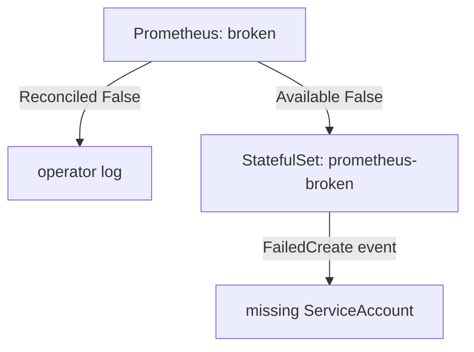

# Find Why A Reconcile Failed

A tenant says its Prometheus server never starts. The custom resource exists, the controller runs, and still there is no pod. This is the most common operator problem on a platform, and the answer is spread over three places: the conditions on the custom resource, the events on the objects it owns, and the controller's log. This part reads all three on the `Prometheus` resource `broken`.

## Start with the custom resource

The printer columns give the first hint without any options:

<!-- astrona:playground:renew -->

```sh
kubectl -n starfleet get prometheus broken
```

You should see:

```text
NAME     VERSION   DESIRED   READY   RECONCILED   AVAILABLE   AGE
broken             1         0       True         False       52s
```

One replica is desired and none is ready. Read the conditions in full, with `reason` and `message`:

```sh
kubectl -n starfleet get prometheus broken \
  -o jsonpath='{range .status.conditions[*]}{.type}{" "}{.status}{" reason="}{.reason}{" message="}{.message}{"\n"}{end}'
```

You should see:

```text
Available False reason=NoPodReady message=
Reconciled True reason= message=
```

`Reconciled True` says the operator did its whole job: it created the StatefulSet, the Service and the Secrets without an error. `Available False` with reason `NoPodReady` says no pod is ready, and the message is empty. The operator does not know why, because pods are not its job. The cause is one step further down the ownership chain.

## Follow the chain to the owned object

The operator owns the StatefulSet `prometheus-broken`, and the built-in StatefulSet controller creates the pods from it. When that controller cannot create a pod, it records an event on the StatefulSet. An event is a short API object that a component writes to report what happened to another object.

```sh
kubectl -n starfleet get statefulset prometheus-broken
kubectl -n starfleet get events --field-selector involvedObject.name=prometheus-broken \
  -o custom-columns=TYPE:.type,REASON:.reason,MESSAGE:.message
```

You should see:

```text
NAME                READY   AGE
prometheus-broken   0/1     51s
TYPE      REASON         MESSAGE
Warning   FailedCreate   Create Pod prometheus-broken-0 in StatefulSet prometheus-broken failed error: pods "prometheus-broken-0" is forbidden: error looking up service account starfleet/prometheus-reader: serviceaccount "prometheus-reader" not found
```

That is the cause. The `Prometheus` resource sets `serviceAccountName: prometheus-reader`, and no ServiceAccount with that name exists in `starfleet`. The API server refuses a pod that names a missing ServiceAccount, so the StatefulSet controller can never create the pod. `kubectl describe statefulset prometheus-broken` shows the same event at the end of its output.

## A reconcile that fails in the operator

Some faults stop the operator itself. Then `Reconciled` turns `False`, and the message and the log say why. Give `broken` a reference to extra scrape configuration in a Secret that does not exist yet. `additionalScrapeConfigs` names a Secret and a key; the operator copies the scrape jobs from that key into the generated Prometheus configuration.

Save this as `prometheus-broken-scrape.yaml`:

```yaml
apiVersion: monitoring.coreos.com/v1
kind: Prometheus
metadata:
  name: broken
  namespace: starfleet
spec:
  replicas: 1
  serviceAccountName: prometheus-reader
  serviceMonitorSelector:
    matchLabels:
      team: starfleet
  resources:
    requests:
      memory: 100Mi
  additionalScrapeConfigs:
    name: extra-scrape
    key: jobs.yaml
```

Apply it:

```sh
kubectl apply -f prometheus-broken-scrape.yaml
```

Then check the conditions a few seconds later:

```sh
kubectl -n starfleet get prometheus broken \
  -o jsonpath='{range .status.conditions[*]}{.type}{" "}{.status}{" reason="}{.reason}{" message="}{.message}{"\n"}{end}'
```

You should see:

```text
Available False reason=NoPodReady message=
Reconciled False reason=ReconciliationFailed message=creating config failed: loading additional scrape configs from Secret failed: secrets "extra-scrape" not found
```

Now the operator could not finish its own work: it cannot build the configuration without the Secret. The operator's log has the same error, with the key of the object that failed:

```sh
kubectl -n default logs deploy/prometheus-operator --since=1m | grep 'level=error' | tail -1
```

You should see a line like this (your time differs):

```text
ts=2026-10-10T18:13:46.456501083Z level=error caller=/workspace/pkg/operator/resource_reconciler.go:699 msg="Unhandled Error" logger=UnhandledError err="sync \"starfleet/broken\" failed: creating config failed: loading additional scrape configs from Secret failed: secrets \"extra-scrape\" not found"
```

The log matters most when a controller writes no conditions at all, or when it fails before it can write status. Search it for the `<namespace>/<name>` of your object.



The diagram shows where to look: a `Reconciled False` condition sends you to the operator's log, and an `Available False` condition with `Reconciled True` sends you down to the owned StatefulSet and its events.

## Fix the causes, not the objects

Fix each cause where it lives. First create the Secret the operator needs. An empty list is a valid set of scrape jobs.

Save this as `secret-extra-scrape.yaml`:

```yaml
apiVersion: v1
kind: Secret
metadata:
  name: extra-scrape
  namespace: starfleet
stringData:
  jobs.yaml: "[]"
```

Apply it, then check the conditions:

```sh
kubectl apply -f secret-extra-scrape.yaml
kubectl -n starfleet get prometheus broken \
  -o jsonpath='{range .status.conditions[*]}{.type}{" "}{.status}{" reason="}{.reason}{"\n"}{end}'
```

You should see (run the second command again if `Reconciled` is still `False`):

```text
secret/extra-scrape created
Available False reason=NoPodReady
Reconciled True reason=
```

The operator watches Secrets, so the new Secret started a reconcile, and this time it worked. Now point the `Prometheus` resource at the ServiceAccount that exists, and wait for it:

```sh
kubectl -n starfleet patch prometheus broken --type merge -p '{"spec":{"serviceAccountName":"prometheus"}}'
kubectl -n starfleet wait --for=condition=Available --timeout=150s prometheus/broken
kubectl -n starfleet get prometheus
```

You should see:

```text
prometheus.monitoring.coreos.com/broken patched
prometheus.monitoring.coreos.com/broken condition met
NAME        VERSION   DESIRED   READY   RECONCILED   AVAILABLE   AGE
broken                1         1       True         True        79s
starfleet             1         1       True         True        79s
```

Both `Prometheus` resources now report `Reconciled True` and `Available True`. You changed only the custom resource and one Secret it reads; the operator updated the StatefulSet, and the StatefulSet controller created the pod.

You can now find why a reconcile failed: read the conditions first, follow the ownership chain to the events of the owned objects when the operator reports success, and read the controller's log when it reports failure. Then fix the cause in the custom resource or in what it references, and let the controller do the rest.

## Common pitfalls

> [!WARNING]
> - **Stopping at `Reconciled True`.** The operator can succeed while the pods still fail. Read `Available` and the events of the owned objects.
> - **Creating the pod or the StatefulSet by hand.** The controller owns them and changes them back. Fix the custom resource.
> - **Creating a ServiceAccount with the wrong name to silence the error.** It may work, but the RBAC binding for Prometheus names `prometheus`, so the new account cannot read any targets.
> - **Reading old log lines.** Use `--since` and search for the `<namespace>/<name>` key, so you read the error for this object and this attempt.
