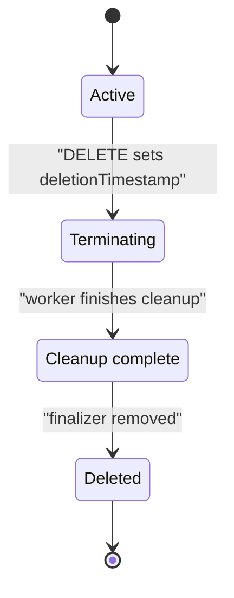

# Finalizers And deletionTimestamp

A delete request can succeed while the object stays in the cluster. A finalizer is a name in `metadata.finalizers` that prevents the Kubernetes application programming interface (API) server from removing an object until cleanup finishes. This matters for platform services that must release resources before their request disappears.

## Request deletion and read what changed

The ConfigMap `scout-settings` stores non-secret configuration. It has the custom finalizer `platform.starfleet.io/cleanup`. The playground defines its cleanup contract: delete the separate ConfigMap `scout-cache`, then remove that finalizer. A suspended Kubernetes Job, a resource that runs a task to completion, is the worker responsible for this example. No worker pod runs while the Job is suspended.

<!-- astrona:playground:renew -->

Keep the finalizer and cleanup annotation in the manifest. An annotation is metadata that records information without acting as a selector. Save this as `configmap-scout-settings.yaml`:

```yaml
apiVersion: v1
kind: ConfigMap
metadata:
  name: scout-settings
  namespace: starfleet
  annotations:
    platform.starfleet.io/cleanup-job: scout-cleanup
  finalizers:
    - platform.starfleet.io/cleanup
data:
  PODINFO_UI_MESSAGE: hello from starfleet
```

Apply it:

```sh
kubectl apply -f configmap-scout-settings.yaml
```

You should see:

```text
configmap/scout-settings unchanged
```

Then check its deletion fields:

```sh
kubectl -n starfleet get configmap scout-settings -o jsonpath='deletionTimestamp={.metadata.deletionTimestamp} finalizers={.metadata.finalizers}{"\n"}'
```

You should see:

```text
deletionTimestamp= finalizers=["platform.starfleet.io/cleanup"]
```

The deletion timestamp is empty. The object is active, and the finalizer is already in place. Request deletion without making your terminal wait:

```sh
kubectl -n starfleet delete configmap scout-settings --wait=false
```

You should see:

```text
configmap "scout-settings" deleted from starfleet namespace
```

The word `deleted` reports that the request was accepted. It does not prove that finalization finished. Read the object again:

```sh
kubectl -n starfleet get configmap scout-settings -o jsonpath='deletionTimestamp={.metadata.deletionTimestamp} finalizers={.metadata.finalizers}{"\n"}'
kubectl -n starfleet get configmap scout-settings -o custom-columns=NAME:.metadata.name,DATA:.data
```

You should see:

```text
deletionTimestamp=2026-10-12T16:04:53Z finalizers=["platform.starfleet.io/cleanup"]
NAME             DATA
scout-settings   map[PODINFO_UI_MESSAGE:hello from starfleet]
```

Your timestamp differs. `metadata.deletionTimestamp` records when deletion was requested, and the finalizer is still present. The object is in a terminating state, but the ordinary ConfigMap table has no `STATUS` column to show that state. Read metadata instead of relying on the table.

The API server keeps the object so the cleanup worker can still read it. The API server does not know what `platform.starfleet.io/cleanup` means and does not run cleanup code for it. The responsible component must notice deletion, perform its work, and remove its own finalizer. All finalizers must be gone before the API server removes the object.



The diagram shows that a successful delete request starts finalization, while the cleanup worker and API server complete different steps.

## What deletion prevents

Once deletion starts, you cannot clear the deletion timestamp to make the object active again. You may remove existing finalizers, but you cannot add a new one. Try adding a second custom finalizer:

```sh
kubectl -n starfleet patch configmap scout-settings --type=json -p '[{"op":"add","path":"/metadata/finalizers/-","value":"platform.starfleet.io/extra"}]'
```

You should see:

```text
The ConfigMap "scout-settings" is invalid: metadata.finalizers: Forbidden: no new finalizers can be added if the object is being deleted, found new finalizers []string{"platform.starfleet.io/extra"}
```

The API server rejects the change. The existing finalizer remains in place. The worker must finish the current deletion; recreating a similar object is a separate create request after the old object is gone.

A finalizer name is not an owner reference. An owner reference links a dependent to its owner so the garbage collector can find it. A finalizer holds an individual object until cleanup completes. Both can affect the same deletion, but a custom finalizer can also protect an object with no owner references, as `scout-settings` does here.

Kubernetes uses built-in finalizers for work such as foreground garbage collection and storage protection. Custom names include a domain and a slash, such as `platform.starfleet.io/cleanup`, so a component can identify the cleanup it owns. A name alone does not install that component or prove it is healthy.

You can now distinguish an accepted delete request from a completed deletion by reading the timestamp and finalizers. You also know why another delete request or `--wait=false` does not resolve this state. The remaining work is to find why the responsible worker has not finished.

## Common pitfalls

> [!WARNING]
> - **Trusting the word `deleted` without checking the object.** The API can accept deletion while finalizers keep the object visible.
> - **Expecting every table to show `Terminating`.** ConfigMaps have no status column for it; inspect deletionTimestamp.
> - **Expecting Kubernetes to run code from a finalizer name.** The responsible component must implement the cleanup.
> - **Adding a finalizer after deletion begins.** The API server permits removal of existing finalizers but rejects new ones.
