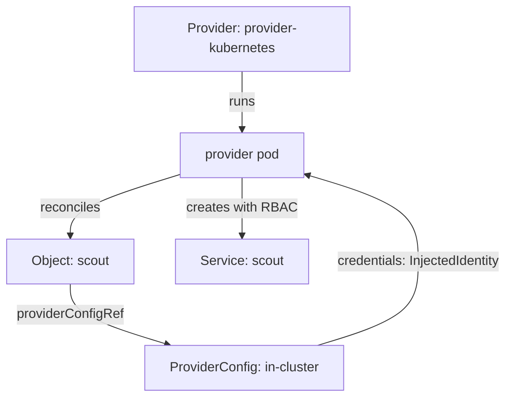

# Install A Crossplane Provider And ProviderConfig

Crossplane turns a Kubernetes cluster into a control plane for other systems. On its own, Crossplane manages only packages. To manage anything else, you install a provider, tell it how to connect, and give it the permissions it needs. This module walks through those three steps with the one provider that works offline, `provider-kubernetes`.

<!-- astrona:playground -->

A provider is a Crossplane package that installs custom resource definitions (CRDs) and a controller for one external system. A managed resource is one object that a provider controls. A ProviderConfig is the object that tells a provider how to connect and which credentials to use. Here the "external system" is the same cluster, so the whole module runs without a cloud account. The same steps apply to a cloud provider; only the ProviderConfig credentials change.

The module has three parts. **Crossplane And Provider Packages** checks that Crossplane is healthy and installs `provider-kubernetes`. **ProviderConfig And Injected Identity** connects the provider to the cluster and shows which permissions it still lacks. **Managed Resources And Failed Syncs** creates an `Object`, reads its `Synced` and `Ready` conditions, and repairs a sync that fails because of missing permissions.

## Learning objectives

After this module you can:

- Confirm that Crossplane's pods, CRDs and package manager are healthy before you install a package.
- Install a provider package and read `INSTALLED` and `HEALTHY` from `kubectl get providers`.
- Configure a ProviderConfig for `provider-kubernetes` that uses an injected identity, and grant its service account the RBAC (role-based access control) it needs.
- Create a managed resource directly and read its `Synced` and `Ready` conditions.
- Diagnose a managed resource that is not `Synced` because the provider lacks permissions.

## Before you start

You need Kubernetes basics: namespaces, Services, ServiceAccounts, Roles and RoleBindings, and the commands `kubectl get`, `kubectl apply`, `kubectl describe` and `kubectl auth can-i`. You do not need to know Crossplane yet.

Write each example file in a new, empty folder on your machine and run every command from that folder. Your playground runs Kubernetes 1.35.8 and Crossplane 2.4.2 in a single-node `kind` cluster. Crossplane runs in the namespace `crossplane-system`. The namespaces `starfleet` and `outpost` exist and are empty. No provider is installed. Installing one pulls a package from `xpkg.crossplane.io`, so the playground needs outbound internet access.

The diagram shows the chain the module builds: the provider pod reads the ProviderConfig, reconciles the `Object`, and creates the Service only if its service account has permission.
