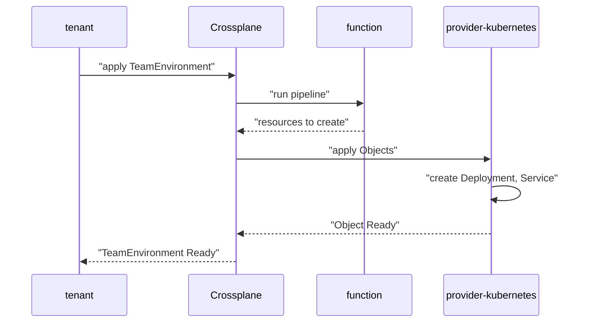

# Request A Composite Resource

A platform team wants tenants to ask for a workload without knowing how it is built. The tenant writes a few lines of YAML, and the platform creates the Deployment, the Service and anything else that is needed. This part shows that request from the tenant side, and then shows which component does each step.

## Apply one small object

A tenant applies a `TeamEnvironment` in its own namespace. In Crossplane 2.x, a composite resource is namespaced by default, so the request lives in `outpost` next to the tenant's other objects. The tenant needs no permission on Deployments or on `provider-kubernetes` objects. The tenant only needs permission on `TeamEnvironment`.

<!-- astrona:playground:renew -->

Save this as `teamenvironment-scout-env.yaml`:

```yaml
apiVersion: platform.starfleet.io/v1alpha1
kind: TeamEnvironment
metadata:
  name: scout-env
  namespace: outpost
spec:
  team: outpost
  size: small
```

Apply it:

```sh
kubectl apply -f teamenvironment-scout-env.yaml
```

You should see:

```text
teamenvironment.platform.starfleet.io/scout-env created
```

The API server only stores the object. Crossplane does the work after that, so the command returns before anything is running.

## Wait for the Ready condition

A condition is an entry in `status.conditions` with a `type`, a `status`, a `reason` and a `message`. Crossplane writes two conditions on every composite resource. `Synced` is `True` when Crossplane ran the Composition and applied the result without an error. `Ready` is `True` when every resource the Composition created is itself ready.

The two conditions answer different questions. `Synced` asks whether Crossplane could do its job. `Ready` asks whether the result works. A composite resource can be `Synced` and not yet `Ready` while a Deployment starts.

Wait for `Ready`:

```sh
kubectl -n outpost wait teamenvironment/scout-env --for=condition=Ready --timeout=180s
```

The command returns when the condition becomes `True`, and it fails with a timeout when it does not. Now list the request. Crossplane adds the `SYNCED` and `READY` columns to the table:

```sh
kubectl -n outpost get teamenvironment scout-env
```

You should see one row for `scout-env` with `True` in both the `SYNCED` and the `READY` column.

## See which component did what

Four components take part, and each one has its own job. The API server stores the request. Crossplane reads it, selects a Composition and calls the composition function. The function `function-patch-and-transform` returns the list of resources to create. Crossplane applies that list as managed resources, and `provider-kubernetes` creates the real Kubernetes objects from them.



The diagram shows the request going down to the provider and the readiness coming back up to the composite resource.

## Prove the workload answers

A `Ready` condition says that Crossplane is satisfied. It does not say that the application works. The proof is a request to the `scout` Service from the `shuttle` client pod. Check that the Deployment and the Service exist in `outpost` first:

```sh
kubectl -n outpost get deployment,service scout
```

You should see a Deployment `scout` and a Service `scout`. Now send a request from `shuttle` and print only the HTTP status code:

```sh
kubectl -n outpost exec deploy/shuttle -- curl -s -o /dev/null -w '%{http_code}\n' http://scout:9898
```

You should see `200`. If you see `000` or a connection error, the Deployment may still be starting. Run the command again after a few seconds.

The tenant never created the Deployment. Crossplane and `provider-kubernetes` created it from the `TeamEnvironment`. That raises the next question: which objects did one request create, and how do you list them without guessing names?

## Common pitfalls

> [!WARNING]
> - **Reading `Synced: True` as success.** `Synced` only says Crossplane applied the Composition. Wait for `Ready`, then send a request to the workload.
> - **Applying the request in the wrong namespace.** A namespaced composite resource creates its objects for the namespace it lives in. A request in `default` does not provision anything for `outpost`.
> - **Checking the workload right after `apply`.** Crossplane works after the command returns. Use `kubectl wait` before the first check.

## Your mission: Provision A TeamEnvironment And Prove It Answers

You can now request a composite resource from a tenant namespace and prove that the workload it provisions answers. The mission asks you to request a `TeamEnvironment` from `outpost`, wait for `Ready`, and show that `scout` returns `200` to a request from `shuttle`.

First pause the playground:

```sh
astrona stop ats-019-playground-030-03
```

Start the lab, then submit your work when you are done:

```sh
astrona run --git ssh://git@github.com/astrona-io/ATS019.git -c sections/section-030/module-03/labs/lab-01
astrona submit -c sections/section-030/module-03/labs/lab-01
```

When the lab is finished, remove it and start the playground again:

```sh
astrona destroy ats-019-lab-030-03
astrona start ats-019-playground-030-03
```
