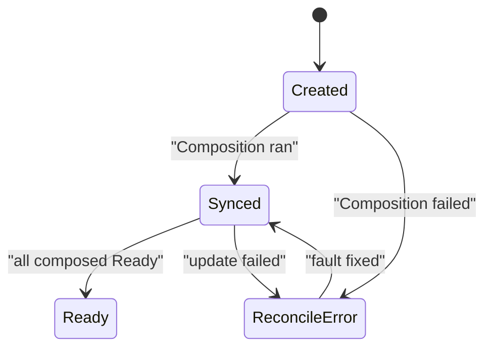

# Read A Failing Composite Resource

A composite resource that never becomes `Ready` gives the tenant no error message from the command line. The tenant sees a request that stays pending. The platform engineer must find which object fails and why, and the conditions and events on the composite resource say where to look.

## Know the states of a request

A healthy composite resource goes through a short series of states. It starts without conditions. Crossplane then runs the Composition and sets `Synced` to `True`. The composite resource stays not ready while the composed resources start. When every composed resource is ready, `Ready` becomes `True`.

A failure leaves the request in one of two states. If Crossplane cannot run the Composition, `Synced` becomes `False` with the reason `ReconcileError`. If Crossplane runs the Composition but a composed resource never gets ready, `Synced` stays `True` and `Ready` stays `False`.



The diagram shows that `ReconcileError` is a state you can leave once you fix the fault.

## Request the broken Composition

The playground has a second Composition, `teamenvironment-with-cache`. It is broken on purpose. A request selects a Composition with `spec.crossplane.compositionRef.name`, so this request chooses the broken one.

<!-- astrona:playground:renew -->

Save this as `teamenvironment-cache-env.yaml`:

```yaml
apiVersion: platform.starfleet.io/v1alpha1
kind: TeamEnvironment
metadata:
  name: cache-env
  namespace: outpost
spec:
  team: outpost
  size: small
  crossplane:
    compositionRef:
      name: teamenvironment-with-cache
```

Apply it:

```sh
kubectl apply -f teamenvironment-cache-env.yaml
```

Then check the result after about 30 seconds:

```sh
kubectl -n outpost get teamenvironment cache-env
```

You should see `cache-env` with `False` in the `SYNCED` column, or `True` in `SYNCED` and `False` in `READY`. The row alone does not say why.

## Read the condition and the event

Start with the conditions. The `message` of a failing condition holds the error text that Crossplane received:

```sh
kubectl -n outpost get teamenvironment cache-env -o jsonpath='{range .status.conditions[*]}{.type}{"  "}{.status}{"  "}{.reason}{"  "}{.message}{"\n"}{end}'
```

Each line shows a condition type, its status, its reason and its message. Read the line for `Synced` first. Then read the events, which Crossplane records for each reconcile error:

```sh
kubectl -n outpost describe teamenvironment cache-env
```

The `Events` section at the end of the output lists the warnings. Both the condition message and the event come from the same error, so you can use whichever is easier to read. Events expire after about an hour, and the condition stays, so prefer the condition when you review an old failure.

## Find the missing function

The first fault is a pipeline step that names a function that is not installed. A function is a package, like a provider. A Composition step points at it by name in `functionRef.name`. When that function does not exist, Crossplane cannot run the step and the whole pipeline fails.

Two commands confirm the cause. List the installed functions, then read the pipeline of the broken Composition:

```sh
kubectl get functions
kubectl get composition teamenvironment-with-cache -o jsonpath='{range .spec.pipeline[*]}{.step}{"  "}{.functionRef.name}{"\n"}{end}'
```

The first command lists the installed functions. The second prints each pipeline step with the function it calls. Compare the names. A function name in the Composition that is not in the first list is the fault. The fix is either to install the function, or to change the Composition to use one that is installed.

## Find the misspelled patch

The second fault is a patch that names a field that does not exist. The Composition copies a value from one field of the composite resource into a field of a composed resource. A misspelled name in `fromFieldPath` or `toFieldPath` points at nothing.

Read the patches of the Composition and compare each path with the real field names:

```sh
kubectl get composition teamenvironment-with-cache -o yaml
```

Look at each `fromFieldPath`. It must match a field of the `TeamEnvironment` spec, such as `spec.size`. Compare it with the fields the XRD defines:

```sh
kubectl get xrd teamenvironments.platform.starfleet.io -o jsonpath='{.spec.versions[0].schema.openAPIV3Schema.properties.spec.properties}{"\n"}'
```

You should see the real field names. A path in the Composition that is not in that list is the misspelling.

## Move down the tree

When the composite resource is `Synced` but not `Ready`, trace it and look for the row that is not ready:

```sh
crossplane resource trace teamenvironment cache-env -n outpost -o wide
```

Then describe that `Object`. Its conditions and events come from `provider-kubernetes`, not from Crossplane's composition engine, so a `Synced` error there usually means that the manifest inside the `Object` is wrong or that the `ProviderConfig` has no permission.

You now have a method with three steps. Read the conditions on the composite resource, trace down to the row that is not ready, and read the conditions and events on that object. The method works for any Composition. A last question remains: what happens to all of these objects when the tenant changes or deletes the request?

## Common pitfalls

> [!WARNING]
> - **Reading only the composite resource.** The reason for a `Ready: False` is often on a composed `Object` further down the tree.
> - **Relying on events.** Events expire. Read `status.conditions` and keep the message.
> - **Fixing the Composition and expecting an instant change.** Crossplane reconciles on a timer. Wait a minute or check again before you assume the fix did not work.

## Your mission: Fix A Failing Composition Found By Tracing

You can now find the failing object in a composite resource and read its condition. The mission gives you a request that stays not ready. You must find the faults in its Composition, fix them in the Composition and not in the request, and show that the request reaches `Ready` and that `scout` answers.

First pause the playground:

```sh
astrona stop ats-019-playground-030-03
```

Start the lab, then submit your work when you are done:

```sh
astrona run --git ssh://git@github.com/astrona-io/ATS019.git -c sections/section-030/module-03/labs/lab-02
astrona submit -c sections/section-030/module-03/labs/lab-02
```

When the lab is finished, remove it and start the playground again:

```sh
astrona destroy ats-019-lab-030-03-02
astrona start ats-019-playground-030-03
```
