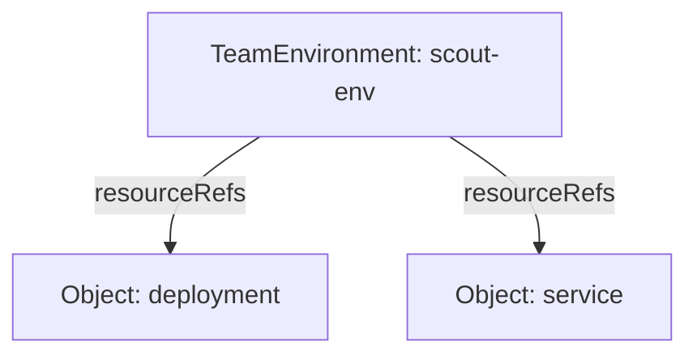

# Trace With The Crossplane CLI

A composite resource can be `Synced` while one of its children still fails.
Listing the children one at a time makes it easy to miss the cause. The
Crossplane command-line interface (CLI) reads the whole resource tree and
shows each object's conditions beside its name. A composite resource is one
object of a platform application programming interface (API); composed
resources are the objects Crossplane
creates for it.

## Install the pinned CLI

The playground already provides CLI 2.4.1. It is released separately from
Crossplane 2.4.2. The command in this CLI is `crossplane resource trace`;
`crossplane beta trace` is the older command name.

<!-- astrona:playground:renew -->

To install the same CLI in a Linux terminal, first check its architecture:

```sh
uname -m
```

For `x86_64`, run the following commands. For `aarch64` or `arm64`, replace
`linux_amd64` with `linux_arm64` in the download address. The local `bin`
directory needs no administrator access. The `PATH` setting makes the shell
find this downloaded binary first for the rest of this terminal session:

```sh
mkdir -p bin
curl -fsSL --retry 3 https://cli.crossplane.io/stable/v2.4.1/bin/linux_amd64/crossplane -o bin/crossplane
chmod +x bin/crossplane
export PATH="$PWD/bin:$PATH"
crossplane resource trace --help
```

Look for the `--namespace` and `--output` options. The CLI reads the same
Kubernetes configuration as `kubectl`, including the `KUBECONFIG` environment
variable. Keep both commands pointed at the playground.

## Read a namespaced tree

Apply the request again so the commands work even if you removed it earlier. Save this as `teamenvironment-scout-env.yaml`:

```yaml
apiVersion: platform.starfleet.io/v1alpha1
kind: TeamEnvironment
metadata:
  name: scout-env
  namespace: outpost
spec:
  team: outpost
  size: small
  crossplane:
    compositionRef:
      name: teamenvironment
```

Apply it:

```sh
kubectl apply -f teamenvironment-scout-env.yaml
```

Then check the result:

```sh
crossplane resource trace teamenvironment scout-env -n outpost
crossplane resource trace teamenvironment scout-env -n outpost -o wide
```

The root row is `TeamEnvironment/scout-env` in `outpost`. The indented
`Object` rows are its children. Their generated names can differ between
requests. Read `SYNCED` and `READY` on every row. A dash means that the
condition has not been set; it is not a successful result. Repeat the trace
while the controllers reconcile.

Wide output adds `RESOURCE`, the logical resource name from the Composition,
such as `deployment` or `service`. It also keeps the full condition message
in `STATUS`. Default output keeps only the last 64 characters of a long
message, which can hide the name or context you need.



The tree shows Composition resource names for the children; the actual
`Object` names are generated and appear in the CLI's `NAME` column.

## Find the cause behind a row

For each row, the printer first checks deletion and retrieval errors. It
then reads `Synced` and `Ready` from `status.conditions`. If both are true,
`STATUS` shows the ready reason. Otherwise it prefers the failing `Synced`
reason and message when present, then the failing `Ready` reason and message.
A parent message about unready children tells you to inspect those children;
the child's message usually names the failed operation.

The playground also contains a broken Composition. Select it for this
request, then inspect its full error:

```sh
kubectl -n outpost patch teamenvironment scout-env --type=merge -p '{"spec":{"crossplane":{"compositionRef":{"name":"teamenvironment-with-cache"}}}}'
crossplane resource trace teamenvironment scout-env -n outpost -o wide
kubectl -n outpost get teamenvironment scout-env -o jsonpath='{range .status.conditions[*]}{.type}{"  "}{.status}{"  "}{.reason}{"  "}{.message}{"\n"}{end}'
```

Repeat the commands until Crossplane has processed the change. Look for the
missing function in the `Synced` message. A pipeline failure can occur before
any children are created. Children from a previous successful reconcile may
still be listed, so a healthy child does not disprove a parent pipeline error.
The CLI displays recorded status; it does not run the pipeline or repair it.

## Follow the same references with kubectl

For a namespaced composite resource in this version, the CLI follows
`spec.crossplane.resourceRefs`. Each reference gives an API version, kind and
name. The CLI uses the parent's namespace for a child reference without an
explicit namespace, fetches the child and repeats the traversal if that child
is itself a composite resource. It reads conditions from each fetched object.

Print the references, then replace `<OBJECT_NAME>` with one of their names:

```sh
kubectl -n outpost get teamenvironment scout-env -o jsonpath='{range .spec.crossplane.resourceRefs[*]}{.apiVersion}{"  "}{.kind}{"  "}{.name}{"\n"}{end}'
kubectl -n outpost get objects.kubernetes.m.crossplane.io <OBJECT_NAME> -o yaml
```

The child's `status.conditions` contains the same reason and message as the
trace. Its `spec.forProvider.manifest` describes the Kubernetes object that
`provider-kubernetes` applies. That wrapped Deployment or Service is a separate
layer: this trace follows composition references, rather than discovering
every object a provider creates. Use `kubectl` to inspect that layer too.

You can now install the pinned CLI, read each row and recover the full error
message. The tree is a compact view of stored resource references and
conditions. Saving the failing child's identity and condition before repair
preserves the diagnosis after the controllers replace the error with success.

## Common pitfalls

> [!WARNING]
> - **Leaving out `-n outpost`.** The CLI uses the current configuration's namespace when you omit it. It may look for the request in the wrong namespace.
> - **Reading only the root's `READY` column.** Follow unready child names and read `STATUS` with `-o wide`; a truncated message can hide the cause.
> - **Recording conditions after repair.** Copy the failing reason and full message first. Reconciliation changes them.
