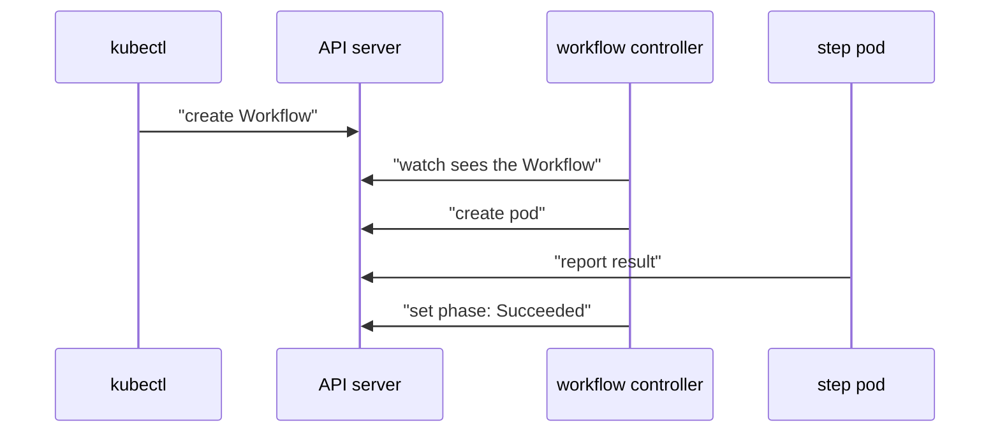

# What Argo Workflows Runs

A provisioning job often needs several steps in a fixed order, and each step may need a different tool. You could write one long shell script, but then you lose the status of each step. Argo Workflows turns each step into its own pod and records the result of every pod in one object, so you can see which step worked and which one failed.

## A Workflow is an object that the controller turns into pods

Argo Workflows adds new resource types to the Kubernetes API with CRDs. The most important one is `Workflow` in the group `argoproj.io`. A Workflow has a list of `templates` and an `entrypoint`, which names the template that runs first. A template is one unit of work. The simplest kind is a `container` template, which runs one container.

<!-- astrona:playground:renew -->

Save this as `workflow-hello.yaml`:

```yaml
apiVersion: argoproj.io/v1alpha1
kind: Workflow
metadata:
  generateName: hello-
  namespace: starfleet
spec:
  entrypoint: say-hello
  templates:
    - name: say-hello
      container:
        image: curlimages/curl
        command: ["sh", "-c"]
        args: ["echo hello from the workflow"]
```

The field `generateName` asks the API server to add a random suffix, so you can submit the same file many times. That works only with `kubectl create`, because `kubectl apply` needs a fixed name. Create the Workflow:

```sh
kubectl create -f workflow-hello.yaml
```

You should see one line that starts with `workflow.argoproj.io/hello-` and ends with `created`. Then read the Workflow:

```sh
kubectl -n starfleet get workflows
```

You should see one row for the Workflow, with a `STATUS` column. The column shows `Running` first and `Succeeded` after the pod finishes.

The workflow controller did the work. It runs in the namespace `argo`, watches Workflow objects and creates a pod in the namespace of the Workflow. It also writes the progress back into `status` of the same Workflow. Your `kubectl create` only stored the object.

## Follow the Workflow to its pod

Every pod that the controller creates carries the label `workflows.argoproj.io/workflow` with the name of its Workflow. List the pods with that label:

```sh
kubectl -n starfleet get pods -l workflows.argoproj.io/workflow
```

You should see one pod for the `say-hello` step. Each step pod has two containers named `main` and `wait`. The `main` container runs your image and command. The `wait` container is the Argo executor, which collects the result when `main` ends and reports it back. Read the output of your step:

```sh
kubectl -n starfleet logs -l workflows.argoproj.io/workflow -c main
```

You should see the line `hello from the workflow`.



The diagram shows that `kubectl` only stores the Workflow, while the workflow controller creates the pod and the pod reports its result back through the API server.

## Read the phase and the nodes

The Workflow stores its progress in `status`. The field `status.phase` is the state of the whole run. It is `Running` while steps work and ends as `Succeeded`, `Failed` or `Error`. `Failed` means a step failed. `Error` means the controller could not run the workflow at all. Read the phase of the newest Workflow:

```sh
kubectl -n starfleet get workflows -o jsonpath='{.items[-1].status.phase}{"\n"}'
```

You should see `Succeeded`. The field `status.nodes` holds one entry per step, called a node. Each node has its own `phase`, a `displayName` and a `message` when something went wrong. You will read nodes when a step fails.

The `argo` command-line tool reads the same objects and prints them as a tree. It also needs no extra setup in the playground:

```sh
argo -n starfleet list
argo -n starfleet get @latest
```

You should see the Workflow with its status and a tree of its steps. The name `@latest` selects the newest Workflow. The tool is a convenience. Everything it shows also lives in `kubectl get workflow -o yaml`.

You now know that a Workflow is a normal API object, that the workflow controller turns each step into a pod, and where the phase and the logs live. One Workflow file is still a single run. The next part turns it into a reusable definition with input values.

## Common pitfalls

> [!WARNING]
> - **Using `kubectl apply` with `generateName`.** The API server needs a name. Use `kubectl create`.
> - **Reading logs without `-c main`.** The pod has a `wait` container too, so you may read the executor logs instead of your step.
> - **Expecting `kubectl get workflows` to show the step output.** It shows only the phase. Read the pod logs for output.
> - **Looking for the pod in the `argo` namespace.** Step pods run in the namespace of the Workflow, here `starfleet`.
