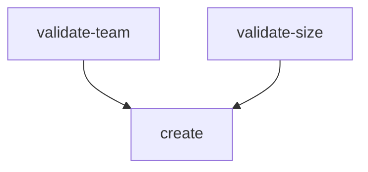

# Build A Reusable WorkflowTemplate

A platform team does not want to paste a Workflow file for every request. It wants one definition that takes the team name, the namespace and the size as input. A WorkflowTemplate does that. It stores the definition in the cluster, and each run becomes a normal Workflow.

## Parameters, steps and a template reference

A WorkflowTemplate has the same `spec` as a Workflow. It adds nothing but a name and a place to live. Input values are `spec.arguments.parameters`: a list of names with optional default values. A template reads a parameter with the expression `{{workflow.parameters.<name>}}`.

The `steps` template runs lists of steps in order. Each outer list item is one stage. Steps inside the same stage run at the same time. The `dag` template (directed acyclic graph) runs tasks in an order set by `dependencies`: a task starts when all tasks it names are done. Use `steps` for a simple sequence. Use `dag` when some tasks can run in parallel.

<!-- astrona:playground:renew -->

Save this as `workflowtemplate-provision-environment.yaml`:

```yaml
apiVersion: argoproj.io/v1alpha1
kind: WorkflowTemplate
metadata:
  name: provision-environment
  namespace: starfleet
spec:
  entrypoint: main
  arguments:
    parameters:
      - name: team
        value: outpost
      - name: replicas
        value: "1"
  templates:
    - name: main
      steps:
        - - name: validate
            template: say
            arguments:
              parameters:
                - name: message
                  value: "validating request for {{workflow.parameters.team}}"
        - - name: create
            template: say
            arguments:
              parameters:
                - name: message
                  value: "creating {{workflow.parameters.replicas}} replica(s)"
    - name: say
      inputs:
        parameters:
          - name: message
      container:
        image: curlimages/curl
        command: ["sh", "-c"]
        args: ["echo \"{{inputs.parameters.message}}\""]
```

The template `main` has two stages, so `validate` runs before `create`. Both stages call the template `say`, which takes its own input parameter `message`. Apply it:

```sh
kubectl apply -f workflowtemplate-provision-environment.yaml
```

Then check the result:

```sh
kubectl -n starfleet get workflowtemplates
```

You should see `provision-environment` in the list. Creating a WorkflowTemplate runs nothing. It only stores the definition.

## Submit a Workflow from the template

A Workflow starts a stored template with `workflowTemplateRef`. Values in `spec.arguments.parameters` of the Workflow are merged with the defaults of the template, and the Workflow wins. Save this as `workflow-from-template.yaml`:

```yaml
apiVersion: argoproj.io/v1alpha1
kind: Workflow
metadata:
  generateName: provision-
  namespace: starfleet
spec:
  workflowTemplateRef:
    name: provision-environment
  arguments:
    parameters:
      - name: replicas
        value: "2"
```

Create it:

```sh
kubectl create -f workflow-from-template.yaml
```

Then read the output of the `create` step:

```sh
kubectl -n starfleet logs -l workflows.argoproj.io/workflow -c main --tail=5
```

You should see the text `creating 2 replica(s)` in the logs of the newest Workflow, not `creating 1 replica(s)`. The value `2` replaced the default, and the value of `team` stayed at its default `outpost`. If the log list shows older Workflows too, run `kubectl -n starfleet get workflows` to find the newest name and use `-l workflows.argoproj.io/workflow=<name>` instead.

The `argo` tool does the same in one command and can override a parameter with `-p`:

```sh
argo -n starfleet submit --from workflowtemplate/provision-environment -p replicas=3 --watch
```

You should see the steps finish one after the other and the Workflow end as `Succeeded`.

## Replace the steps with a DAG

A sequence is wrong when two checks do not depend on each other. A DAG lets both run at once and then waits for both. Save the same file again with a `dag` template as the entrypoint. Replace the content of `workflowtemplate-provision-environment.yaml` with this:

```yaml
apiVersion: argoproj.io/v1alpha1
kind: WorkflowTemplate
metadata:
  name: provision-environment
  namespace: starfleet
spec:
  entrypoint: graph
  arguments:
    parameters:
      - name: team
        value: outpost
      - name: replicas
        value: "1"
  templates:
    - name: graph
      dag:
        tasks:
          - name: validate-team
            template: say
            arguments:
              parameters:
                - name: message
                  value: "team {{workflow.parameters.team}} is known"
          - name: validate-size
            template: say
            arguments:
              parameters:
                - name: message
                  value: "{{workflow.parameters.replicas}} replica(s) is allowed"
          - name: create
            dependencies: [validate-team, validate-size]
            template: say
            arguments:
              parameters:
                - name: message
                  value: "creating the environment"
    - name: say
      inputs:
        parameters:
          - name: message
      container:
        image: curlimages/curl
        command: ["sh", "-c"]
        args: ["echo \"{{inputs.parameters.message}}\""]
```

Apply it and run it again:

```sh
kubectl apply -f workflowtemplate-provision-environment.yaml
argo -n starfleet submit --from workflowtemplate/provision-environment --watch
```

You should see `validate-team` and `validate-size` start together and `create` start only after both finish. The Workflow ends as `Succeeded`.



The diagram shows two independent tasks that must both finish before `create` starts.

Existing Workflows keep the definition they started with. A change to the WorkflowTemplate affects only Workflows that you submit afterwards, because the controller copies the template into the Workflow when it starts the run.

You can now store a provisioning flow once, pass input to it and choose between a sequence and a DAG. So far every step only prints text. A real step must change the cluster, and the Kubernetes API will ask who the step is. The next part gives the workflow an identity.

## Common pitfalls

> [!WARNING]
> - **Writing parameter values as numbers.** Parameter values are strings. Write `"2"`, not `2`.
> - **Using `{{inputs.parameters.x}}` outside a template that declares it.** At the top level, use `{{workflow.parameters.x}}`.
> - **Putting steps of one stage in separate lists.** Each outer list item is a new stage, so those steps run one after the other.
> - **Expecting a template change to affect a running Workflow.** Only new Workflows use the new definition.
