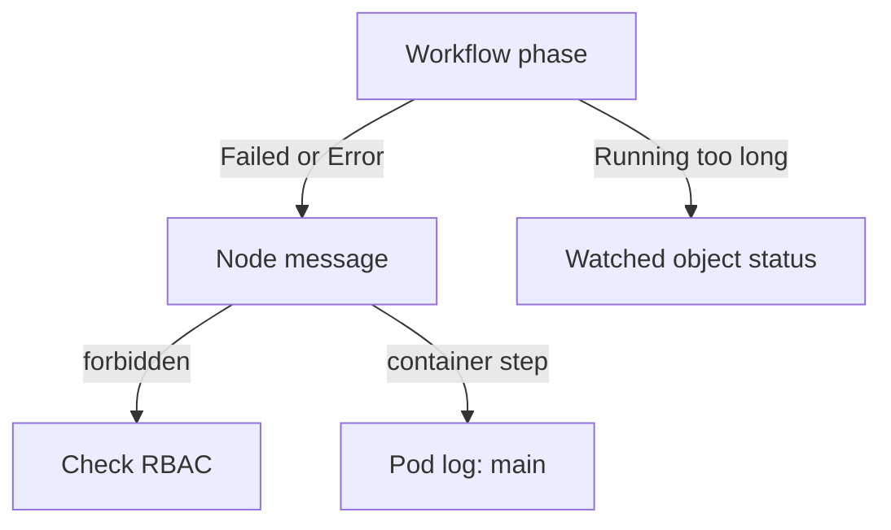

# Create A Platform API Object And Wait For Ready

A self-service workflow should ask the platform API for an environment, not build the environment itself. The workflow creates a `TeamEnvironment` and waits until a controller reports that it is ready. This part uses a resource step with a `successCondition` for that wait.

## A resource step that creates a TeamEnvironment

A `successCondition` is an expression that Argo evaluates against the object the step created. The step watches the object and ends as soon as the expression is true. A `failureCondition` ends the step as failed. Without a condition, a resource step ends right after the object is created. The expression uses the field path of the object, such as `status.phase == Ready`.

The playground CRD `teamenvironments.platform.starfleet.io` has no controller, so you will play the controller yourself. The workflow reads the field `status.phase`. First give `provisioner` the right to manage `TeamEnvironment` objects in `outpost`. A step that waits also needs `get`, `list` and `watch`. Save this as `role-provisioner-teamenvironment.yaml`:

<!-- astrona:playground:renew -->

```yaml
apiVersion: rbac.authorization.k8s.io/v1
kind: Role
metadata:
  name: provisioner-teamenvironment
  namespace: outpost
rules:
  - apiGroups: ["platform.starfleet.io"]
    resources: ["teamenvironments"]
    verbs: ["get", "list", "watch", "create"]
---
apiVersion: rbac.authorization.k8s.io/v1
kind: RoleBinding
metadata:
  name: provisioner-teamenvironment
  namespace: outpost
subjects:
  - kind: ServiceAccount
    name: provisioner
    namespace: starfleet
roleRef:
  kind: Role
  name: provisioner-teamenvironment
  apiGroup: rbac.authorization.k8s.io
```

Apply it:

```sh
kubectl apply -f role-provisioner-teamenvironment.yaml
```

Now save this as `workflow-request-environment.yaml`:

```yaml
apiVersion: argoproj.io/v1alpha1
kind: Workflow
metadata:
  generateName: request-environment-
  namespace: starfleet
spec:
  serviceAccountName: provisioner
  entrypoint: request
  templates:
    - name: request
      resource:
        action: create
        successCondition: status.phase == Ready
        failureCondition: status.phase == Failed
        manifest: |
          apiVersion: platform.starfleet.io/v1alpha1
          kind: TeamEnvironment
          metadata:
            name: outpost-env
            namespace: outpost
          spec:
            team: outpost
            replicas: 1
```

A resource step manages one object, and `create` needs a fixed name here so that you can find the object. Create the Workflow:

```sh
kubectl create -f workflow-request-environment.yaml
```

Then look at the Workflow and the object:

```sh
kubectl -n starfleet get workflows
kubectl -n outpost get teamenvironments
```

You should see the Workflow in the phase `Running` and the object `outpost-env`. The step created the object. It now waits, because nothing sets `status.phase`. A running workflow with no error is the normal state of a waiting step.

## Satisfy the condition

In a real platform, a controller writes the status. Here you write it. The command patches the `status` subresource, which is the separate endpoint a controller uses to write status:

```sh
kubectl -n outpost patch teamenvironment outpost-env --subresource=status --type=merge -p '{"status":{"phase":"Ready"}}'
```

The step pod watches the object, so it sees the change. Read the Workflow again:

```sh
kubectl -n starfleet get workflows
```

You should see the newest Workflow end as `Succeeded`. The step ended because the expression became true.

Run the workflow a second time to see the other side. Delete the object first, because the name is fixed:

```sh
kubectl -n outpost delete teamenvironment outpost-env
kubectl create -f workflow-request-environment.yaml
kubectl -n outpost patch teamenvironment outpost-env --subresource=status --type=merge -p '{"status":{"phase":"Failed"}}'
```

You should see the new Workflow end as `Failed`, because `failureCondition` became true. The node message names the condition that matched.

## Read a stuck or failed workflow

A step with a `successCondition` can wait for a long time, and it has no timeout unless you set one. Add `activeDeadlineSeconds` to the template or the Workflow when a wait must end. When a Workflow does not move, work through the same order each time. Read `status.phase` of the Workflow. Read the nodes to find the one that is not `Succeeded`. For a resource step, read the object that it watches, because the answer is often in its status. For a container step, read the `main` container log.



The diagram shows where to look next, depending on the phase and the message.

You now know how to make a workflow create a platform API object, wait for the platform to report `Ready`, and find out why a step stops or fails. In a full platform, the controller or the Crossplane Composition writes that status, and the same Workflow works without change.

## Common pitfalls

> [!WARNING]
> - **Expecting the step to end after `create`.** With a `successCondition`, the step waits for the condition.
> - **Missing `watch` and `list` in the Role.** The step can create the object but cannot see the change that it waits for.
> - **Reusing a fixed object name.** The second `create` fails with `AlreadyExists`. Delete the old object or use a new name.
> - **Writing status with a normal patch.** With the status subresource enabled, use `--subresource=status`.
