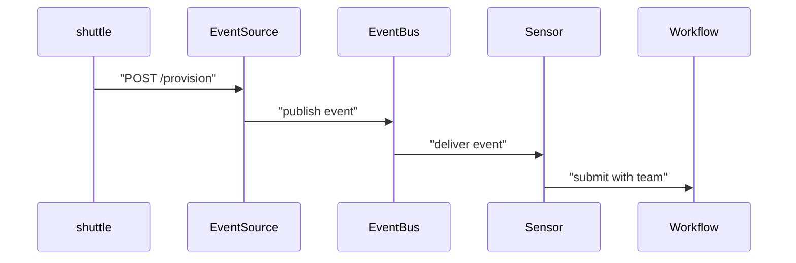

# EventBus And Webhook EventSource

A tenant team asks the platform for an environment. If a person must read the request and start the provisioning by hand, the platform is not self-service. Argo Events lets the cluster receive the request itself. This part builds the receiving side: an EventBus and a webhook EventSource.

## Three objects, three jobs

An event is a small message that says something happened. In Argo Events, an event has a source name, an event name, and data. A webhook event carries the HTTP request: its headers and its body.

The EventSource is a custom resource that receives events from an outside system and publishes them. A webhook EventSource starts an HTTP server inside a pod. The EventBus is a custom resource that sets up a message bus (the transport that carries events) for one namespace. In Argo Events 1.9 the EventBus runs NATS JetStream. A Sensor reads events from the EventBus, and you write it in the next part.



The diagram shows the path of one request. The `shuttle` pod posts JSON to the EventSource, the EventSource publishes it to the EventBus, and the Sensor submits a Workflow with a parameter from the JSON.

## Create the EventBus

Every EventSource and Sensor in a namespace needs an EventBus. By default, they look for an EventBus named `default`. If you use another name, you must set `eventBusName` in both the EventSource and the Sensor.

<!-- astrona:playground:renew -->

Save this as `eventbus-default.yaml`:

```yaml
apiVersion: argoproj.io/v1alpha1
kind: EventBus
metadata:
  name: default
  namespace: starfleet
spec:
  jetstream:
    version: latest
```

Apply it:

```sh
kubectl apply -f eventbus-default.yaml
```

Then check the result:

```sh
kubectl -n starfleet get eventbus default
kubectl -n starfleet get pods
```

The Argo Events controller reads the EventBus and creates a StatefulSet of JetStream pods. Wait until those pods are ready before you continue. An EventSource created too early waits for the bus, so it is safer to wait.

## Create the webhook EventSource

The webhook EventSource holds one or more named webhooks. Each one has a `port`, an `endpoint` (the URL path) and a `method`. The name under `webhook`, here `request`, becomes the event name that a Sensor refers to later.

The `service` block asks the controller to create a Kubernetes Service in front of the EventSource pod. Without it, no other pod can reach the HTTP server by name.

Save this as `eventsource-provision.yaml`:

```yaml
apiVersion: argoproj.io/v1alpha1
kind: EventSource
metadata:
  name: provision
  namespace: starfleet
spec:
  service:
    ports:
      - port: 12000
        targetPort: 12000
  webhook:
    request:
      port: "12000"
      endpoint: /provision
      method: POST
```

Apply it:

```sh
kubectl apply -f eventsource-provision.yaml
```

Then check the result:

```sh
kubectl -n starfleet get eventsource provision
kubectl -n starfleet get service provision-eventsource-svc
kubectl -n starfleet get pods -l eventsource-name=provision
```

The controller names the Service `<EventSource name>-eventsource-svc`. You should see the EventSource, the Service on port `12000`, and one running pod that carries the label `eventsource-name=provision`.

## Send the first event

The `shuttle` pod plays the role of a tenant client. Send a JSON body with the header `Content-Type: application/json`, so the EventSource parses it as JSON:

```sh
kubectl -n starfleet exec deploy/shuttle -- curl -s -o /dev/null -w '%{http_code}\n' \
  -X POST -H 'Content-Type: application/json' \
  -d '{"team":"outpost","tier":"standard"}' \
  http://provision-eventsource-svc.starfleet.svc:12000/provision
```

You should see `200`. The code comes from the EventSource, which answers after it accepts the request. Nothing else happens yet, because no Sensor listens. The EventBus holds the event, and no Workflow starts.

Read the EventSource log to confirm that it published the event:

```sh
kubectl -n starfleet logs -l eventsource-name=provision
```

The log has a line for the received request and a line for the published event. The exact text depends on the version, so look for the endpoint `/provision` and the event name `request`.

Two requests that the EventSource refuses show how strict the webhook is. A `GET` to `/provision` gets an error status, because `method` is `POST`. A `POST` to `/other` gets `404`, because no webhook uses that endpoint.

You now have a running receiver and have seen a request reach it. The event went into the EventBus and ended there. The next part adds the Sensor that picks it up.

## Common pitfalls

> [!WARNING]
> - **No `service` block in the EventSource.** The pod runs, but no Service exists, so `curl` cannot resolve the name.
> - **Wrong `method` or `endpoint`.** The EventSource refuses the request. The Sensor never sees an event.
> - **Missing `Content-Type: application/json`.** The body is not parsed as JSON, so a later filter or parameter on `body.team` finds nothing.
> - **An EventBus not named `default`.** The EventSource and Sensor wait for a bus they cannot find, unless you set `eventBusName` in both.
