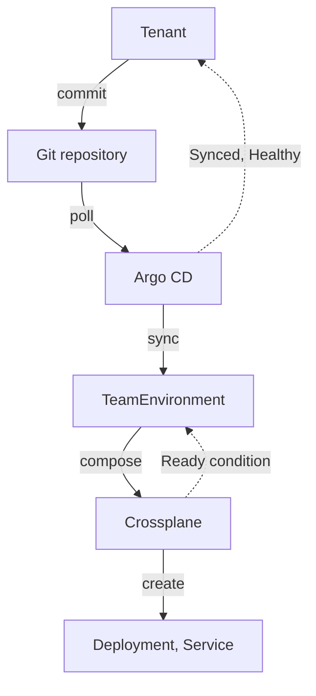

# Follow A Request From Commit To Ready

A request has passed only when the composite resource reports `Ready`. Between the commit and `Ready`, three components act: Git stores the file, Argo CD applies it, and Crossplane builds the objects. A failure can happen in any of the three. This part sends one request through, then breaks it, and reads the status that says where it stopped.



The diagram shows that Argo CD only applies the file, and Crossplane only builds the objects. Each reports its own status.

## Commit the request

The Git server runs inside the cluster, so you reach it through a port-forward from your machine. A port-forward is a `kubectl` tunnel from a local port to a Service. Start it and leave it running in a second terminal:

```sh
kubectl -n gitea port-forward svc/gitea-http 3000:3000
```

<!-- astrona:playground:renew -->

In your first terminal, clone the repository as the user `platform`. The password is the one the playground sets for that user:

```sh
git clone http://platform:<PLATFORM_PASSWORD>@127.0.0.1:3000/starfleet/outpost-requests.git
```

Save the request from the previous part as `requests/drifter.yaml` inside the clone. Then commit and push it:

```sh
cd outpost-requests
git add requests/drifter.yaml
git commit -m "Request environment for drifter"
git push
```

Git is only the transport here. The platform value is that the commit is a reviewed, recorded request. The exam tasks ask for the manifest and the Application, not for Git skills.

Argo CD polls the repository about every three minutes. Ask it to look now:

```sh
kubectl -n argocd annotate application outpost-requests argocd.argoproj.io/refresh=hard --overwrite
```

## Read the status in order

Check the Application first, because it tells you whether the file arrived:

```sh
kubectl -n argocd get application outpost-requests -o jsonpath='sync={.status.sync.status} health={.status.health.status}{"\n"}'
```

You should see `sync=Synced`. Then check the object that Argo CD created, and the conditions that Crossplane writes on it:

```sh
kubectl -n outpost get teamenvironment drifter
```

You should see a `SYNCED` column and a `READY` column. `SYNCED True` means Crossplane could run the Composition. `READY True` means every composed object is ready. The composed objects take some time, so run the command again if `READY` is still `False`.

Then check that the workload answers:

```sh
kubectl -n outpost get deployment,service
```

You should see the objects that the Composition created for `drifter`, in the `outpost` namespace.

## Read a failure

When a request fails, read the layers from the outside in. First read the Application. A violation of the project, such as a file that names a namespace the project does not allow, shows in `status.conditions` and in the sync result message:

```sh
kubectl -n argocd get application outpost-requests -o jsonpath='{.status.conditions}{"\n"}{.status.operationState.message}{"\n"}'
```

The Application reports `OutOfSync` or a failed operation, and the message names the rule that refused the file. The `TeamEnvironment` never reaches the cluster in this case, so nothing is wrong with Crossplane.

When the Application is `Synced` but the object is not `Ready`, the file arrived and the fault is in the platform. Read the conditions of the composite resource:

```sh
kubectl -n outpost describe teamenvironment drifter
```

Read the `Status` section: each condition has a `Type`, a `Status`, a `Reason` and a `Message`. The `Message` names the composed object or the function that failed.

A third case remains. An invalid request, such as `size: huge`, is refused by the API server when Argo CD applies it. The Application shows the refusal in its sync result, and the CRD schema rule named in the message tells the tenant what to fix. The tenant fixes the file in Git and commits again.

You now know how one request travels and which status to read at each step: Argo CD for the file, the composite resource for the build. The question that remains is how a platform runs checks and steps before it creates the object, which needs a workflow.

## Common pitfalls

> [!WARNING]
> - **Reading only `kubectl get teamenvironment`.** If the object does not exist, the fault is in Git or Argo CD, not in Crossplane. Read the Application first.
> - **Waiting for the three-minute poll.** Use the refresh annotation when you test a change.
> - **Fixing a drifted object with `kubectl edit`.** With `selfHeal: true`, Argo CD reverts it. Change the file in Git.
> - **Assuming `Synced` means `Ready`.** `Synced` on the Application means the file was applied. Only `Ready` on the composite resource means the environment works.

## Your mission: Deliver A Tenant Request Through Argo CD

You can now limit a repository with an AppProject, write an Application with automated sync and follow a request to `Ready`. The mission asks you to fix an Application that cannot deliver a request into `outpost`, and to get a committed `TeamEnvironment` to `Ready`.

Pause the playground first:

```sh
astrona stop ats-019-playground-040-03
```

Start the lab and send your work for grading:

```sh
astrona run --git ssh://git@github.com/astrona-io/ATS019.git -c sections/section-040/module-03/labs/lab-02
astrona submit -c sections/section-040/module-03/labs/lab-02
```

When the lab is done, remove it and start the playground again:

```sh
astrona destroy ats-019-lab-040-03-02
astrona start ats-019-playground-040-03
```
